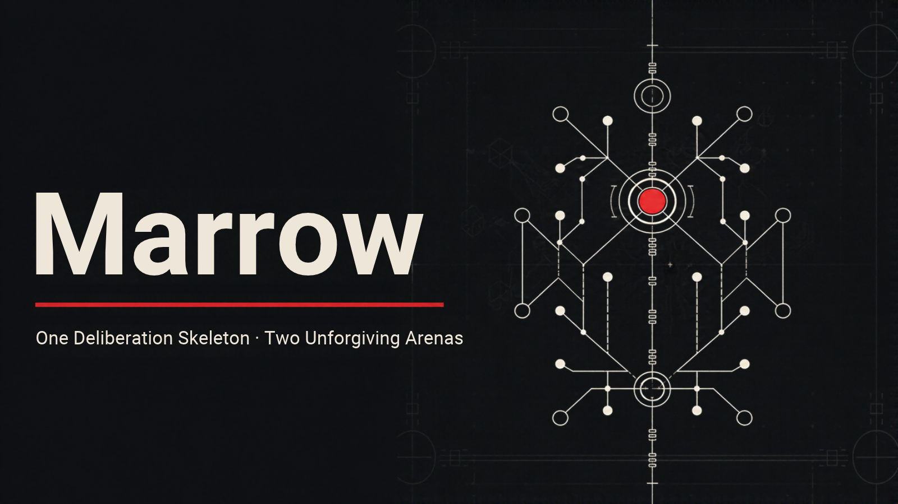

# Marrow



**One deliberation skeleton. Two unforgiving arenas.**

Marrow is a declarative multi-agent cross-examination and evidence-graph skeleton built as a single **Next.js 16 App Router** + **Node.js 26** + **MongoDB** full-stack service. Swap one `DomainSpec` and visual token register to instantiate a completely distinct analytical tribunal—zero changes to orchestration, evidence slicing, SSE streaming, graph layout, or persistence.

## Two Applications Powered by `src/skeleton/`

| Arena | Route | Visual Register | Panel Examiners | Structured Deliverable |
| :--- | :--- | :--- | :--- | :--- |
| **Postmortem Court** | `/court` | Forensic Incident Room (Dark Steel) | SRE Coroner · Security Auditor · Performance Prosecutor | Causal Root-Cause Graph + Postmortem `.md` |
| **Defense Tribunal** | `/defense` | Oxford Editorial Desk (Archival Paper) | Methodology Purist · Novelty Skeptic · Statistical Examiner | Claim Fragility Graph + Rebuttal `.md` |

## Architecture

```text
src/
├── skeleton/                 # Domain-agnostic multi-agent engine & UI kit
│   ├── schema/               # Zod schemas for DomainSpec, EvidenceGraph, SessionRecord
│   ├── engine/               # Evidence slicer, 3-round SSE orchestrator, prompt builder
│   ├── llm/                  # OpenAI-compatible streaming & structured JSON client
│   ├── storage/              # Native MongoDB driver pool & indexed dossier repository
│   ├── api/                  # createDeliberationHandlers(spec) Next.js route factory
│   └── ui/                   # EvidenceRail, DeliberationFeed, SVG EvidenceGraph, TribunalWorkbench
├── apps/
│   ├── postmortem-court/     # App 1: domain.spec.ts + presets.ts + theme.ts + verdict-view.tsx
│   └── defense-tribunal/     # App 2: domain.spec.ts + presets.ts + theme.ts + verdict-view.tsx
└── app/                      # Thin Next.js 16 App Router routes & SSE endpoints
```

## Quick Start

1. Configure environment variables (`.env.local`):
   ```bash
   MONGODB_URI=mongodb://localhost:27017/marrow
   MONGODB_DB=marrow
   OPENROUTER_API_KEY=sk-or-v1-...
   LLM_ROUTING_MODE=ensemble
   ```
   By default, **4-Model Ensemble** routes each seat to a distinct November 2026 model via OpenRouter:
   - Examiner 1: `anthropic/claude-haiku-5.5`
   - Examiner 2: `meta/muse-ember`
   - Examiner 3: `deepseek/deepseek-v4.1-flash-1017`
   - Round 3 Arbiter: `openai/gpt-6.1-terra`

   *(Visitors can also switch to Single Model mode—including the free `inclusionai/ling-3.2-flash:free` tier—or supply their own tab-scoped OpenRouter key in **Model settings**.)*

2. Install and run locally:
   ```bash
   npm install
   npm run dev
   ```

3. Build & run production standalone server (Railway Pro):
   ```bash
   npm run build
   node .next/standalone/server.js
   ```

## Adding a Third Arena

1. Create `src/apps/<your-arena>/domain.spec.ts` implementing `DomainSpec<YourVerdict>`.
2. Mount `createDeliberationHandlers(yourSpec)` under `src/app/api/<your-arena>/sessions/...`.
3. Render `<TribunalWorkbench spec={yourSpec} ... />` in your App Router page.

## License

MIT
